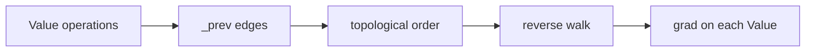

# scalarflow

I rebuilt Andrej Karpathy's micrograd to see reverse-mode autodiff end to end.
Every operation on a `Value` records the local derivative it will need later,
and `backward()` walks the resulting graph in reverse topological order. The
engine and the renderer are 259 lines of Python; the 100 tests are another 951
lines. There are no tensors and no framework in the gradient path.

```python
>>> from scalarflow.engine.value import Value
>>> x = Value(2.0, label="x")
>>> y = Value(3.0, label="y")
>>> z = x * y
>>> z.label = "z"
>>> z.backward()
>>> x.grad, y.grad
(3.0, 2.0)
```

_Multiplication stores the local rules `dz/dx = y` and `dz/dy = x`, so the
gradient that reaches `z` is multiplied by the other operand on the way back._

## Table of contents

- [Source](#source)
- [What is implemented](#what-is-implemented)
- [Reading order](#reading-order)
- [Requirements](#requirements)
- [Run it](#run-it)
- [Tests](#tests)
- [Graph rendering](#graph-rendering)
- [How it works](#how-it-works)
- [Constructor arguments](#constructor-arguments)
- [Design notes](#design-notes)
- [Limits](#limits)
- [Stack](#stack)

## Source

- [karpathy/micrograd](https://github.com/karpathy/micrograd), the reference
  implementation.
- [The spelled-out intro to neural networks and backpropagation](https://www.youtube.com/watch?v=VMj-3S1tku0),
  the lecture this follows.

## What is implemented

| Piece | File | What it does |
| --- | --- | --- |
| `Value` | `scalarflow/engine/value.py` | Wraps a scalar, stores its gradient, and records the operation and parents that produced it. |
| Operators | `scalarflow/engine/value.py` | `+`, `-`, `*`, `/`, `**`, unary negation, and reflected forms for `+`, `-`, `*`, and `/`. |
| Activations | `scalarflow/engine/value.py` | `relu`, `tanh`, and `exp`, each with its own local gradient rule. |
| `Neuron` | `scalarflow/engine/neuron.py` | Weighted sum plus bias through `tanh`, with `parameters()` and `zero_grad()`. |
| `Layer` | `scalarflow/engine/layer.py` | A list of neurons over the same inputs. |
| `MLP` | `scalarflow/engine/mlp.py` | A stack of layers sized from a list, such as `MLP(3, [4, 4, 1])`. |
| Renderer | `scalarflow/plot/graph.py` | Walks `_prev` and emits a Graphviz digraph labelled with the node label, data, and gradient. |

## Reading order

| Order | File | Concept |
| --- | --- | --- |
| 1 | `scalarflow/engine/value.py` | The `Value` node, the operator methods, local gradients, and `backward()`. |
| 2 | `scalarflow/engine/neuron.py` | Turning a weighted sum into a `Value` expression. |
| 3 | `scalarflow/engine/layer.py` | Collecting neurons and flattening their parameters. |
| 4 | `scalarflow/engine/mlp.py` | Chaining layers and checking the size list. |
| 5 | `scalarflow/plot/graph.py` | Reading the graph structure through `_prev`. |
| 6 | `tests/` | The behaviour the engine is expected to keep. |

## Requirements

- Python 3.8 or newer for the engine. The code uses f-strings and `math.tanh`;
  nothing newer is required.
- `pytest` for the test suite. Current pytest needs Python 3.10 or newer, so an
  older interpreter needs an older pytest release.
- The `graphviz` Python package and the system `dot` binary, only for rendering
  graphs. Current graphviz needs Python 3.9 or newer.

## Run it

```bash
git clone https://github.com/abderrahmenex86/scalarflow
cd scalarflow
python3 -m venv venv
source venv/bin/activate
python -m pip install pytest
python -m pytest -q
```

```text
........................................................................ [ 72%]
............................                                             [100%]
100 passed in 0.19s
```

The dot count and the timing depend on the machine. The total is 100 tests.

## Tests

The suite is split by layer: `tests/test_value.py` covers creation, each
operator, the reflected forms, and gradient accumulation when a node is used
more than once; `tests/test_neuron.py` covers weight initialisation, arity
errors, `tanh`, `parameters()`, and `zero_grad()`; `tests/test_layer.py` covers
layer sizing, single-output flattening, parameter counts, and integration with
the MLP. The tests are class-based, so `pytest` collects 100 of them across the
three files.

## Graph rendering

The renderer needs the Python `graphviz` package and the system `dot` binary.
On Debian or Ubuntu:

```bash
python -m pip install graphviz
sudo apt install graphviz
dot -V
```

Then build a graph and render it:

```python
from scalarflow.engine.value import Value
from scalarflow.plot.graph import draw_graph

a = Value(2.0, label="a")
b = Value(3.0, label="b")
c = a * b
c.label = "c"
c.backward()
draw_graph(c).render("graph", view=False)
```

`draw_graph` returns a `Digraph` with `rankdir=LR` and record-shaped nodes. The
call above writes `graph.svg`, plus a `graph` file containing the DOT source.
Each node is labelled `label|data|grad`, so the backward pass is visible in the
image.

## How it works

`Value` stores `data`, `grad`, `label`, `op`, and `_prev`, the set of nodes that
produced it. Every operator builds an output node and assigns its `_backward`
closure. The closure captures only the operands it needs, so addition records
`1.0` for both parents while multiplication records the other operand's data.

`backward()` does a depth-first walk over `_prev`, appends each node after its
children, then iterates that order in reverse. It seeds the output gradient to
`1.0` before the walk. Gradients accumulate with `+=`, which is what makes a
node used twice receive the sum of both paths.

`Neuron` composes the engine directly: a list of `Value` weights, a `Value`
bias, and `tanh` on the weighted sum. `Layer` maps neurons over one input list,
and `MLP` builds layers from consecutive entries in the size list. All three
expose `parameters()` and `zero_grad()`.



```text
scalarflow/engine/value.py   scalar autograd and operators
scalarflow/engine/neuron.py  weighted sum, tanh, parameters
scalarflow/engine/layer.py   list of neurons
scalarflow/engine/mlp.py     stack of layers
scalarflow/plot/graph.py     Graphviz renderer
tests/test_value.py          operator and gradient tests
tests/test_neuron.py         neuron and activation tests
tests/test_layer.py          layer and MLP integration tests
```

## Constructor arguments

| Class | Argument | Meaning |
| --- | --- | --- |
| `Value` | `value` | The scalar data. |
| `Value` | `children` | The nodes that produced this one; defaults to empty. |
| `Value` | `op` | The operation label, such as `"+"` or `"tanh"`. |
| `Value` | `label` | The name shown in the rendered graph. |
| `Neuron` | `n_inputs` | Number of weights; the bias is added separately. |
| `Layer` | `n_inputs`, `n_outputs` | Input width and number of neurons. |
| `MLP` | `n_inputs`, `n_outputs` | Input width and a non-empty list of layer widths. |

`MLP(3, [4, 4, 1])` produces two hidden layers of four neurons and one output
neuron.

## Design notes

I kept the derivative rule next to the operation that needs it: each operation
already knows its local derivative, so the closure captures it. The graph is
just the `_prev` edges the nodes already hold.

The set is deliberate. `_prev` records each producing node once, so `a + a`
contributes a single edge, while the addition's closure still increments `a`
twice. The `visited` set in `backward()` keeps the walk from repeating a node;
`+=` accumulates every path.

The tests are class-based because each class groups one behaviour: creation,
addition, multiplication, division, powers, activations, and accumulation. That
makes a failure point at the rule that broke.

## Limits

Scalar only. There are no tensors and no vectorised operations, so it is far
too slow for real training.

There is no packaging. The repository has no `pyproject.toml` or `setup.py`, so
you import it from the repository root instead of installing it with `pip`.

## Stack

Python 3.8+ · pytest · graphviz (optional, for rendering)
